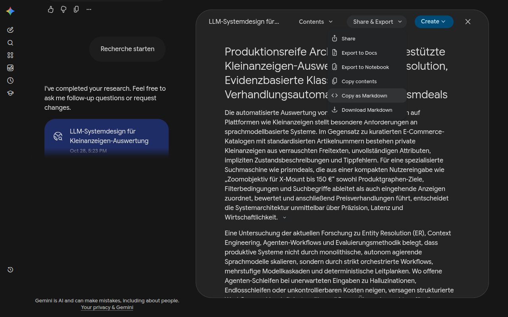

<h1 align="center">Deepdown</h1>

<p align="center">
  <b>Gemini Deep Research reports as clean Markdown. One click.</b><br>
  Headings, tables and formatting kept, citations as footnotes.
</p>

<p align="center">
  
  
  
  
</p>

---

Gemini's *Copy contents* gives you plain text: no headings, no tables, no links behind the citations.

**Deepdown adds two entries to the *Share & Export* menu of every Deep Research report:**

- **Copy as Markdown**
- **Download Markdown**, a `.md` file named after the report

<p align="center"></p>

Gemini already writes its reports in Markdown. Deepdown takes that original, so nothing is lost
in an HTML round trip, and turns every `[cite: 3, 7]` into footnotes with a source list at the end:

```markdown
…die Hinzunahme des Preises lässt die Erkennungsleistung (F1) von 84,96 % auf 66,14 % einbrechen[^1][^2].

## Sources

[^1]: [Entity Matching using Large Language Models - arXiv](https://arxiv.org/pdf/2310.11244)
[^2]: [Entity Matching using Large Language Models - OpenProceedings.org](https://openproceedings.org/2025/conf/edbt/paper-81.pdf)
```

Shift-click either entry to reload the report, e.g. after asking Gemini to change it.

## 🔒 Your data stays yours

Deepdown collects nothing, sends nothing and has no server. It loads the report from
gemini.google.com with your existing login, the same request Gemini makes when you open a chat, and
puts the Markdown into your clipboard or Downloads folder. See [PRIVACY.md](PRIVACY.md).

## 🛠️ Development

One source, two browsers:

```
src/                   code and icons, shared by all browsers
  parse.js             batchexecute response -> report -> Markdown (no DOM)
  content.js           runs in the page: fetches the chat, adds the menu entries
manifests/base.json    shared manifest keys
manifests/firefox.json Gecko ID, minimum version
manifests/chrome.json  minimum Chrome version
scripts/build.mjs      builds build/<browser>/ and dist/*.zip
test/                  node --test
```

```bash
npm run build          # Firefox + Chrome
npm test               # GEMINI_MD_FIXTURE=<captured hNvQHb response> also checks a real report
npm run lint:firefox   # web-ext lint on build/firefox
npm run check:chrome   # loads build/chrome in headless Chrome
```

Load temporarily:
- **Firefox:** `about:debugging` → *This Firefox* → *Load Temporary Add-on* → `build/firefox/manifest.json`
- **Chrome:** `chrome://extensions` → Developer mode → *Load unpacked* → `build/chrome/`

### How it works

Opening a chat, Gemini calls `/_/BardChatUi/data/batchexecute?rpcids=hNvQHb`. The response holds
each Deep Research report as a node `["im_…", null, title, taskId, markdown, [{"44": citations}]]`.
Deepdown sends the same request with the page's session token (`WIZ_global_data`), finds the report
whose id appears in the menu's `jslog`, and converts its citations. Limits: like Gemini, it loads the
10 newest turns of a chat; and it depends on Gemini's internal response layout and menu markup, which
Google can change at any time.

---

<sub>Deepdown is an unofficial project and not affiliated with Google. "Gemini" is a trademark of Google LLC.</sub>

<sub>License: MIT</sub>
